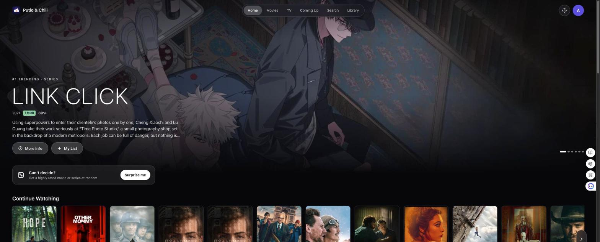
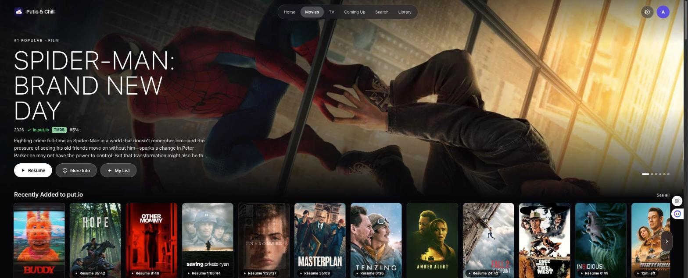
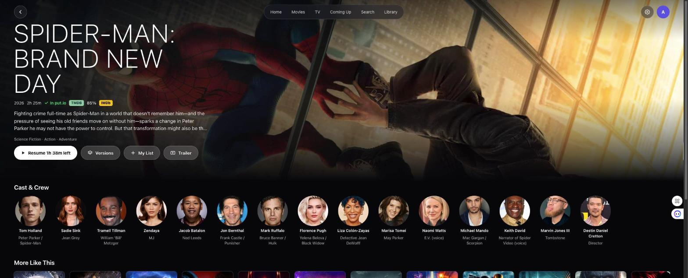
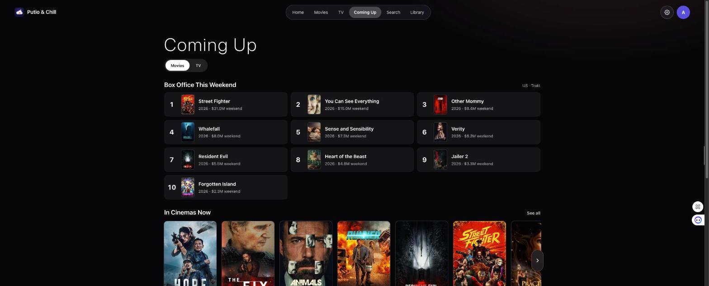
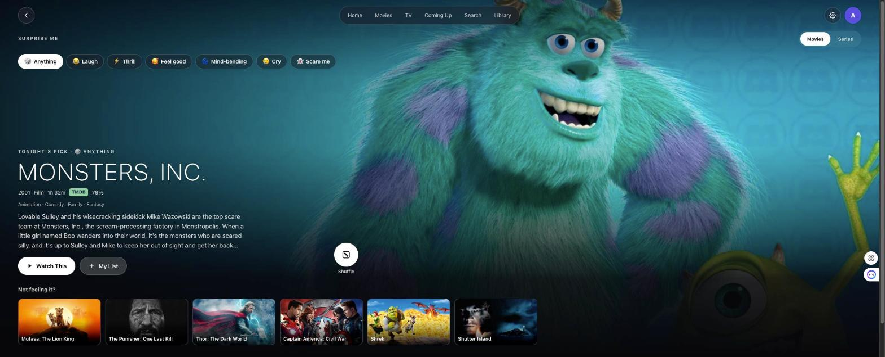

<div align="center">



<br>


**The put.io client for the browser.**<br>
Browse every movie and show, send the best release to put.io in one click,<br>
and watch with your progress and subtitles on any computer.

[Features](docs/FEATURES.md) · [Architecture](docs/ARCHITECTURE.md) · [Development](docs/DEVELOPMENT.md) ·
[iPhone, iPad and Apple TV app](https://github.com/AmirhosseinKhanlari/putio-and-chill)

</div>

<br>

## Why Putio & Chill

put.io is a great place to keep movies and shows. Putio & Chill makes it feel like a streaming service: your library
matched to rich artwork and ratings, smart discovery, one-click "Get & Watch" and a real player. This is the web
version of the [native app](https://github.com/AmirhosseinKhanlari/putio-and-chill): the same library, the same
Get & Watch rules and the same put.io folders, in any modern browser, with nothing to install.

<table>
  <tr>
    <td width="50%" valign="top" align="center">
      
      <h3>Your library, front and center</h3>
      Continue Watching, Recently Added and My List, from a put.io library matched to TMDB and kept in the browser so
      the app opens instantly.
    </td>
    <td width="50%" valign="top" align="center">
      
      <h3>Every title, in depth</h3>
      Full-bleed art, year, runtime, genres, TMDB rating with an IMDb link, trailer, cast and crew, More Like This;
      for shows, every season and episode with stills and the season's best marked.
    </td>
  </tr>
  <tr>
    <td width="50%" valign="top" align="center">
      
      <h3>Coming Up</h3>
      This weekend's box office, what's in cinemas, what's coming soon, and the next episodes of your shows, day by day.
    </td>
    <td width="50%" valign="top" align="center">
      
      <h3>Surprise Me</h3>
      Pick Movies or Series and a mood and get a well-rated pick, with alternatives and Shuffle.
    </td>
  </tr>
  <tr>
    <td width="50%" valign="top">
      <h3>Endless discovery</h3>
      <ul>
        <li>Trending, Popular, Top Rated and genre rows</li>
        <li>New on Netflix and Disney+, New Series, Returning This Week, Critically Acclaimed</li>
        <li>IMDb Top 250 movies and shows, your IMDb watchlist</li>
        <li>Latest Movies and Shows from MyMoviz and chill.institute</li>
        <li>"Because you watched…" from the last thing you played</li>
      </ul>
      <h3>Get &amp; Watch</h3>
      <ul>
        <li>Best release by your rules: quality, size, seeders</li>
        <li>Sent to put.io into Movies / TV Series / Season folders</li>
        <li>Progress, speed and a Ready to watch toast; plays when ready</li>
        <li>Or pick any version yourself, filtered by quality</li>
      </ul>
    </td>
    <td width="50%" valign="top">
      <h3>A real player</h3>
      <ul>
        <li>HLS streaming from put.io, resume synced with the native app</li>
        <li>put.io subtitles + OpenSubtitles search, timing, styles</li>
        <li>Audio tracks, speed, Picture in Picture, full screen</li>
        <li>Keyboard shortcuts like YouTube's (space, ←/→, F, M, &lt; &gt;)</li>
        <li>Next episode card with countdown and auto-play</li>
      </ul>
      <h3>Your put.io, in full</h3>
      <ul>
        <li>Library with filters and storage meter; Files with rename, move, copy, delete, new folder, search</li>
        <li>Trash: restore, delete forever, empty</li>
        <li>Settings shared in spirit with the iPhone app, saved in this browser</li>
      </ul>
    </td>
  </tr>
</table>

## Get started

```bash
git clone https://github.com/AmirhosseinKhanlari/putio-and-chill-web.git
cd putio-and-chill-web
npm install
cp .env.example .env.local      # add your TMDB token (and optional keys)
npm run dev                     # http://localhost:5173
```

Sign in with put.io: the app shows a short code, you enter it at [put.io/link](https://put.io/link). Get & Watch and
Versions search the torrent sources turned on in Settings → Sources (YTS, EZTV, The Pirate Bay, Knaben,
Torrents.csv, TorrentGalaxy); connecting chill.institute in Settings → Connected Services adds its indexers too,
but nothing needs it.

| Key in `.env.local` | For | Get it from |
|---|---|---|
| `VITE_TMDB_TOKEN` | Required: catalog, artwork, matching | themoviedb.org → Settings → API (the *API Read Access Token*) |
| `VITE_TRAKT_CLIENT_ID` | IMDb Top 250, box office | trakt.tv → Your API Apps |
| `VITE_PUTIO_APP_ID` | The put.io app the sign-in code belongs to (a default is set) | put.io → Settings → OAuth apps |

`.env.local` is gitignored. Users sign in to put.io in the app; chill.institute and OpenSubtitles accounts are
optional and live in Settings. Everything (sign-ins, settings, the library cache) stays in the browser's
localStorage; nothing is sent anywhere but the services themselves.

## Under the hood

- **React 18 + TypeScript**, built with Vite, routed with React Router, with TanStack Query for every request and
  hls.js for playback (loaded only when something plays).
- **One shared logic layer**: `src/api/` (put.io, TMDB, Trakt, chill.institute, OpenSubtitles and the release
  sources) and `src/lib/` (release-name parsing, title matching, the library index, Smart Get, folder layout),
  ported from the native app's `AMDBCore` and covered by 150+ Vitest tests.
- **A small same-origin proxy** for the services that don't allow browser requests: the Vite dev server in
  development, a Cloudflare Pages Function in production, both from one allow-list.
- **Static site**: `npm run build` makes `dist/`, deployed to Cloudflare Pages.

<details>
<summary><b>Project layout</b></summary>

```
src/
  api/               put.io, TMDB, chill.institute, OpenSubtitles, people clients
    lists/           TMDB curated lists, Trakt charts, MyMoviz, chill catalog, IMDb watchlist
    sources/         Release sources (YTS, EZTV, apibay, Knaben, Torrents.csv, TorrentGalaxy), aggregator, proxy allow-list
  lib/               Release-name parser, matcher, library index, Smart Get, folders, settings, storage
  pages/             Home, Movies, TV, Coming Up, Search, Library, Files, Trash, Title, Person, Surprise, Player, Settings, Sign in
  components/        Hero, shelves, cards, Get & Watch / Versions, player, file manager and settings parts
  state/             Session (sign-ins), shared hooks (account, library, transfers, My List, toasts)
  styles/            CSS, one file per area
functions/proxy/     Cloudflare Pages Function: the production proxy
public/              Icons and the _redirects file
docs/                Documentation and images
vite.config.ts       Dev server, with the development proxy
```
</details>

## Documentation

| | |
|---|---|
| [**Features**](docs/FEATURES.md) | The complete tour, and what differs from the native app |
| [**Architecture**](docs/ARCHITECTURE.md) | Modules, data flow, the proxy, caching |
| [**Development**](docs/DEVELOPMENT.md) | Setup, testing, deploying, troubleshooting |

## Disclaimer

Putio & Chill is a personal project, not affiliated with put.io, chill.institute, TMDB, IMDb, Trakt, OpenSubtitles or
any release source. You are responsible for what you download; follow the laws where you live and the terms of the
services you connect.

<sub>

&nbsp;This product uses the TMDB API but is not endorsed or certified by TMDB. Artwork in the screenshots comes from TMDB.
</sub>
